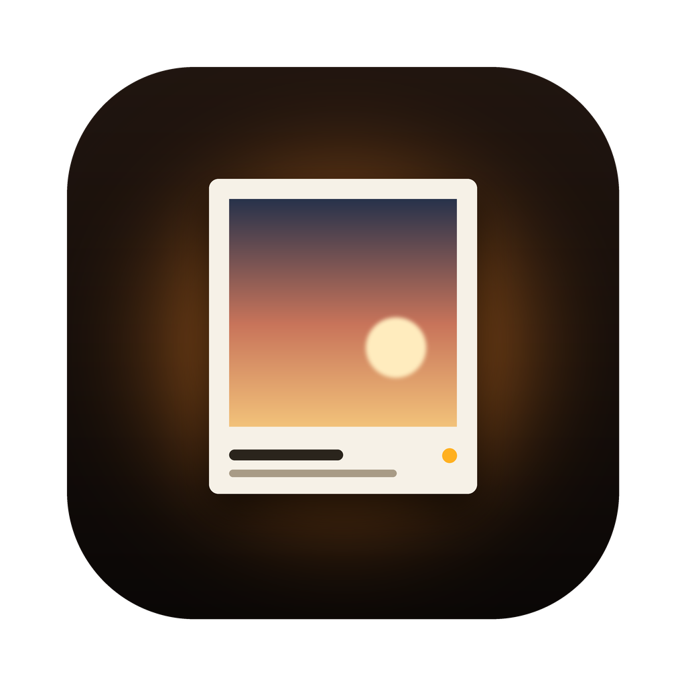

<p align="center">
  
</p>

<h1 align="center">Photo_Lab</h1>

<p align="center">
  替照片加上邊框與相機資訊列，輸出適合 Instagram 的 JPEG。<br>
  照片處理全部在你的 Mac 上完成，不上傳任何東西。
</p>

<p align="center">
  <a href="../../releases/latest"></a>
  
  
  <a href="../../releases/latest"></a>
</p>

<p align="center">
  <a href="#安裝">安裝</a> ·
  <a href="#功能">功能</a> ·
  <a href="#匯出與既有檔案">匯出與既有檔案</a> ·
  <a href="#自備品牌-logo-與字體">自備 logo</a> ·
  <a href="#隱私與網路">隱私與網路</a> ·
  <a href="#從原始碼建置">從原始碼建置</a>
</p>

---

## 安裝

> 需要 **macOS 14** 以上。

1. 從 [Releases](../../releases/latest) 下載 `PhotoLab-<版本>-macOS.dmg`，打開後把 `PhotoLab.app` 拖進「應用程式」。（也可以下載 `.zip`，解壓縮後自己放進去。）
2. App 沒有經過 Apple 公證：第一次請在檔案上按右鍵 → **打開**（或到「系統設定 → 隱私權與安全性」按「仍要打開」）。
3. **品牌 logo 與字體不內含**（商標與授權），請自備，見[自備品牌 logo 與字體](#自備品牌-logo-與字體)。

**更新**：1.1.0 起，App 每天會檢查一次新版，也可以按標題旁的「檢查更新」。有新版時會顯示更新內容，**按下「安裝更新項目」才會安裝**，不會自己偷偷更新。每個更新都經過發佈者的 EdDSA 簽章驗證，被竄改的下載會被拒絕。
從 1.0.x 升級時，請先手動安裝一次 1.1.0 以後的版本。

## 功能

- **邊框**：比例（原始、平均、1:1、2:3、3:2、4:5、3:4、5:4、9:16、16:9）、粗細、白底／模糊背景、圓角與弧度。
- **相機資訊列**：一鍵樣式（經典、簡約置中、logo 機型、只放 logo、完整資訊、左右分開），可勾選機型、鏡頭、焦距、參數、日期。
- **樣式編輯器**：把品牌 logo、機型、鏡頭、焦距、拍攝參數、日期、自訂文字拖進左／中／右區塊；拖移排序、整塊對調，每行可設字級、顏色、粗體、加線；樣式可匯入匯出（`.igstyle.json`）。
- **工作流程**：即時預覽（可縮放）、可調高度的縮圖列、預設組合、多個來源資料夾、批次匯出勾選的照片。
- **輸出品質**：保留原解析度、JPEG 4:4:4 與 ICC 色彩描述檔。
- **外接硬碟**：也支援 exFAT 等外接碟，選「不覆蓋」時保證不會蓋掉既有檔案。

## 匯出與既有檔案

輸出檔名是 `原檔名_ig.jpg`（例如 `IMG_1234_ig.jpg`）。每個輸出檔都記得自己是從哪一張照片做出來的，所以：

- **同一次匯出裡有同名照片**（例如兩個資料夾都有 `IMG_1234.jpg`）：第二張存成 `IMG_1234_ig-2.jpg`，第三張 `-3`，不會互相覆蓋。
- **別張照片的同名輸出永遠不會被覆蓋**：新的輸出會改用下一個空的編號。
- 資料夾改名、搬移、外接碟換了掛載名稱，或在 Lightroom 重新修圖再匯出，都還認得出是同一張照片。

「來源與輸出」卡片裡的 **既有檔案** 決定照片「自己上次的輸出」已經存在時怎麼做（仿 Lightroom）：

| 選項 | 做法 |
|---|---|
| 每次詢問（預設） | 匯出前跳出提示，告訴你有幾張已有輸出、其中幾張設定不同，再讓你選下面三種之一 |
| 自動改名（-2） | 保留上次的輸出，另存一份新編號 |
| 覆蓋 | 用這次的結果取代上次的輸出 |
| 略過 | 不匯出這些照片 |

「管理來源…」會列出每個來源的照片數，以及在目前輸出資料夾裡 **已輸出** 的張數。

> **注意**：同一張原片的不同版本（例如彩色版和黑白版）請用**不同的檔名**，放在不同資料夾但檔名相同時，會被當成同一張。
> 1.2 以前做出的輸出沒有記錄來源，只能依檔名判斷。

## 自備品牌 logo 與字體

1. 建立並打開資料夾（終端機貼上這兩行，或在 Finder 按 ⌘⇧G 貼上路徑）：

   ```sh
   mkdir -p ~/Library/Application\ Support/Photo_Lab/logos
   open ~/Library/Application\ Support/Photo_Lab/logos
   ```

2. 把 logo 的 PNG 放進去，**檔名用小寫品牌名（只留英文字母與數字）**：

   | 相機品牌 | 檔名 |
   |---|---|
   | Canon / Sony / Nikon | `canon.png` / `sony.png` / `nikon.png` |
   | Fujifilm / Panasonic / Leica | `fujifilm.png` / `panasonic.png` / `leica.png` |
   | OM System | `omsystem.png` |
   | Olympus、Ricoh、Pentax、Sigma、Hasselblad、DJI、Apple、GoPro… | 同樣小寫，例如 `olympus.png` |

3. 檔案要求：**PNG**、背景透明、深色 logo（預設是白邊）、單檔 5 MB 以下。
   用「模糊背景」（深色底）時，可另外放淺色版 `品牌名_dark.png`（例如 `sony_dark.png`），深色背景會優先用它。
4. App 內也有說明：選單列「說明 → 自備品牌 logo 與字體…」會列出路徑與規則，並可一鍵打開資料夾。
5. 切換一下樣式或重新開啟 App，頁尾就會出現 logo。沒有檔案的品牌會顯示成純文字。

**字體**：放到 `~/Library/Application Support/Photo_Lab/fonts/`（`.ttf`／`.otf`／`.ttc`），之後在「進階 → 字體」裡選用。請只使用你有權使用的字體。

## 隱私與網路

- **照片不會離開你的 Mac**：讀取、處理、輸出都在本機完成。
- **唯一的網路連線是檢查更新**：每天一次連到 GitHub（`github.com` 與它的下載伺服器），GitHub 會看到你的 IP 與 App 版本。
- 輸出檔不寫入 GPS 與相機序號。每個輸出的 JPEG 註解會帶一個**來源 ID**：它是用只存在你這台 Mac 的金鑰算出的雜湊，無法從分享出去的照片反推出檔名、路徑或拍攝資訊；不過同一張原圖在同一台 Mac 做出的分享圖會帶相同的 ID，拿到多張的人看得出它們出自同一張原圖。

App 的資料都在這裡，刪掉就是全新狀態：

| 檔案 | 內容 |
|---|---|
| `~/Library/Application Support/Photo_Lab/settings.json` | 設定、來源清單、預設組合 |
| `~/Library/Application Support/Photo_Lab/source.key` | 來源 ID 的金鑰。刪掉後，舊的輸出不再被認成「自己的」（新匯出會改存新編號，不會覆蓋） |
| `~/Library/Application Support/Photo_Lab/logos/`、`fonts/` | 你自備的 logo 與字體 |
| `~/Library/Caches/Photo_Lab/` | 縮圖快取 |

## 從原始碼建置

<details>
<summary><b>macOS 原生版</b>（需要 Xcode 命令列工具，Swift 6）</summary>

```sh
cd swift/PhotoLab
./run.sh                     # 建置 release 版並啟動（debug 版慢很多）
swift test                   # 單元測試：存檔（含 exFAT 情境）、輸出命名、樣式編輯
./package.sh                 # dist/PhotoLab.app、zip 與 dmg（乾淨版，不含 logo）
./package.sh --with-logos    # 把你自己的 logos/ fonts/ 一起包進去（只給自己用，不要外傳）
```

存檔測試也可以在 exFAT 上跑：`PHOTOLAB_TEST_DIR=<exFAT 上的資料夾> swift test`。

**發佈新版**（需要鑰匙圈裡的 Sparkle 私鑰）：更新 `VERSION` 與 `CHANGELOG.md`，commit 並 push 到 `main`，再執行

```sh
./release.sh --publish       # 從已 push 的 main 重新打包、簽章 appcast，建立 GitHub Release
```

</details>

<details>
<summary><b>Python 版</b>（跨平台，也是輸出的參考實作）</summary>

建議 Python 3.12 + Tk 9（macOS 內建的 Tk 8.5 會顯示成黑畫面）：

```sh
python3 -m venv .venv && .venv/bin/pip install -r python/requirements.txt
.venv/bin/python python/ig_border_gui.py
```

兩個版本的輸出對照：`.venv/bin/python tools/compare_swift.py`（需要先 `swift build -c release`）。

</details>

### 目錄

```
swift/PhotoLab/   原生 macOS 版（PhotoLabCore 渲染核心、PhotoLabApp 介面、photolab-render 命令列工具）
python/           Python 版與參考渲染器
assets/ styles/   圖示與樣式範例
logos/ fonts/     放你自己的品牌 logo 與字體（不進 git）
tools/            對照腳本、圖示產生
CHANGELOG.md      更新紀錄
VERSION           版本號（唯一來源）
```

## 授權與商標

專案本身尚未附授權條款。

本專案與 Canon、Sony、Nikon、Fujifilm 等相機品牌及其公司**沒有任何關聯，也未獲其認可**。文中與程式裡出現的品牌名稱僅用來說明相機型號，商標屬於各自的擁有者。品牌 logo 與字體本專案不提供也不內含；請只使用你有權使用的檔案。
